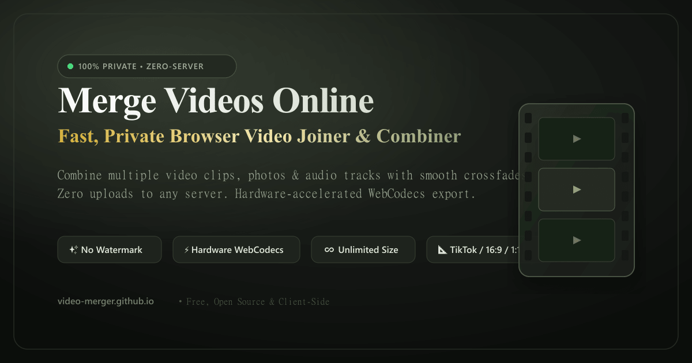
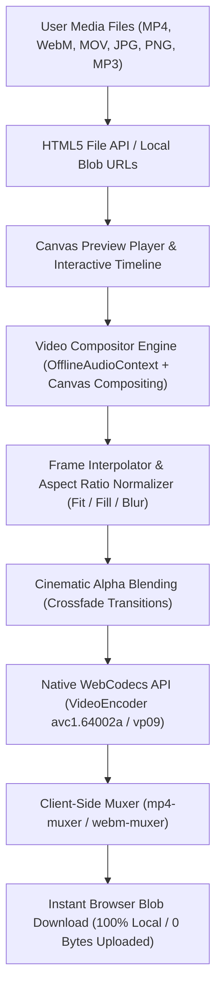

# 🎬 Merge Videos | Free Zero-Server Video Joiner & Combiner

<p align="center">
  <a href="https://video-merger.github.io/">
    
  </a>
</p>

<p align="center">
  <strong>Fast, private, client-side video merger running 100% in your web browser. Zero server uploads, no watermarks, and unlimited file handling.</strong>
</p>

<p align="center">
  <a href="https://video-merger.github.io/"><strong>🌐 Live Website: https://video-merger.github.io/</strong></a>
</p>

<p align="center">
  
  
  
  
  
  
  
</p>

---

## 🌟 Overview

**Merge Videos** (`video-merger.github.io`) is an open-source, zero-server multimedia compositor built for modern web browsers. Unlike legacy online video tools that upload gigabytes of sensitive user footage to third-party cloud servers, **Merge Videos performs 100% of video decoding, canvas compositing, transition rendering, audio mixing, and video encoding locally in browser memory**.

Your media files never leave your device. There are no upload wait times, no server queues, no file size limitations, and absolutely no watermarks.

---

## ✨ Key Features

- 🛡️ **100% In-Browser Privacy**: Confidential files are processed entirely via local WebAssembly, WebCodecs, and HTML5 Canvas. Zero bytes uploaded to any remote server.
- ⚡ **Hardware-Accelerated WebCodecs**: Leverages your device's native GPU with modern `VideoEncoder` and `mp4-muxer` to export high-bitrate video in seconds.
- 💎 **No Watermarks, Free Forever**: Export clean, unbranded videos ready for commercial use, client deliverables, YouTube, TikTok, or Instagram.
- 🎞️ **Interactive Filmstrip Timeline**: Drag-and-drop sequence reordering, clip duplication, and instant frame-accurate trimming modal.
- 📐 **Social Aspect Ratio Presets**:
  - **16:9** Widescreen (YouTube & Desktop)
  - **9:16** Vertical (TikTok, Instagram Reels, YouTube Shorts)
  - **1:1** Square (Instagram Feed & LinkedIn)
  - **5:4** Portrait (Social Feeds & Ads)
- 🖼️ **Intelligent Crop Modes**:
  - **Fit with border**: Preserves original framing with clean letterboxing.
  - **Zoom & Crop to Fill**: Scales video to fill the target aspect ratio seamlessly.
  - **Blurred Background**: Generates a real-time blurred backdrop of the video to eliminate harsh black bars.
- 🔀 **Cinematic Crossfade Transitions**: Smooth alpha blending between consecutive video clips and photos.
- 🎵 **Dual-Track Audio Mixer**: Balance original clip audio and external soundtrack tracks with independent volume sliders.
- 🌓 **Luxury Design System**: Elegant Sand & Moss aesthetic with smooth dark and light mode switching.
- 🌐 **7-Language Localization**: Full localized user experience in English (`/`), Spanish (`/es`), Portuguese (`/pt`), German (`/de`), French (`/fr`), Japanese (`/ja`), and Simplified Chinese (`/zh`).
- 🏆 **100% Technical SEO**: Comprehensive metadata, Open Graph cards, PWA manifest, and Google-compliant JSON-LD structured data (`WebApplication`, `HowTo`, `FAQPage`, `WebSite`, `BreadcrumbList`).

---

## 🏗️ Architecture & How It Works



---

## 🛠️ Tech Stack

| Layer | Technology |
| :--- | :--- |
| **Static Site Generator** | [Astro 5](https://astro.build/) (SSG with sub-second page loads) |
| **Interactive UI** | [React 19](https://react.dev/) + [TypeScript](https://www.typescriptlang.org/) |
| **Styling** | [Tailwind CSS 3.4](https://tailwindcss.com/) (Custom luxury palette: Sand, Moss, Studio Dark) |
| **Video Encoding** | [WebCodecs API](https://developer.mozilla.org/en-US/docs/Web/API/WebCodecs_API) (`VideoEncoder`, `AudioEncoder`) |
| **Container Muxing** | [mp4-muxer](https://github.com/Vanilagy/mp4-muxer) & [webm-muxer](https://github.com/Vanilagy/webm-muxer) |
| **Audio Processing** | [Web Audio API](https://developer.mozilla.org/en-US/docs/Web/API/Web_Audio_API) (`OfflineAudioContext`, `GainNode`) |
| **Icons** | [Lucide React](https://lucide.dev/) |
| **Analytics** | Google Tag (`gtag.js` - `G-R255X1EMS2`) |

---

## 📊 Technical Specifications

| Parameter | Specification |
| :--- | :--- |
| **Supported Video Input** | MP4 (`H.264 / AVC`), WebM (`VP8 / VP9`), MOV (`QuickTime`) |
| **Supported Image Input** | JPEG, PNG, WebP |
| **Supported Audio Input** | MP3, WAV, AAC, OGG |
| **Export Video Containers** | MP4 (`ISO Base Media File Format`), WebM |
| **Export Quality** | **High Quality (14 Mbps VBR High-Profile H.264 / VP9)** |
| **Export Audio** | High-Fidelity 192 kbps stereo AAC / Opus |
| **Frame Rates** | Native 30 FPS / 60 FPS compositor timeline |
| **Data Privacy** | 100% Client-side; zero network requests during editing or rendering |

---

## 📁 Project Structure

```text
video-merger.github.io/
├── public/
│   ├── apple-touch-icon.png    # 180x180 iOS PWA icon
│   ├── favicon.svg             # Scalable brand vector icon
│   ├── icon-192.png            # 192x192 PWA launcher icon
│   ├── icon-512.png            # 512x512 PWA splash icon
│   ├── manifest.json           # Progressive Web App manifest
│   ├── og-image.png            # 1200x630 Social Graph preview card
│   ├── og-image.svg            # Vector source for social preview
│   ├── robots.txt              # Search engine crawler directives
│   └── sitemap.xml             # XML sitemap with 7 hreflang alternates
├── scripts/
│   └── generate-assets.mjs     # Automated sharp asset generation script
├── src/
│   ├── components/
│   │   ├── studio/
│   │   │   ├── CanvasPlayer.tsx       # Real-time HTML5 canvas scrubber & preview
│   │   │   ├── ExportBar.tsx          # Pinned bottom export controls & status
│   │   │   ├── ExportModal.tsx        # Live progress bar & download modal
│   │   │   ├── FilmstripTimeline.tsx  # Drag-and-drop video sequencer
│   │   │   ├── HeroDropzone.tsx       # Landing drag-and-drop dropzone
│   │   │   ├── InspectorSidebar.tsx   # Aspect ratios, crop modes & audio mixer
│   │   │   └── TrimModal.tsx          # Precision video trimming modal
│   │   ├── Navbar.astro               # Accessible navigation bar with theme toggle
│   │   ├── SeoContent.astro           # Semantic SEO content, HowTo guide & FAQs
│   │   ├── StructuredData.astro       # JSON-LD Schema markup (FAQ, HowTo, WebApp)
│   │   └── VideoMergerStudio.tsx      # Main React Island studio orchestrator
│   ├── i18n/
│   │   └── translations.ts            # Multilingual copy for 7 languages
│   ├── layouts/
│   │   └── BaseLayout.astro           # Base HTML layout with SEO meta & fonts
│   ├── pages/
│   │   ├── [lang]/
│   │   │   └── index.astro            # Localized routes (/es, /pt, /de, /fr, /ja, /zh)
│   │   └── index.astro                # Primary English landing page (/)
│   ├── styles/
│   │   └── global.css                 # Global CSS and Tailwind directives
│   └── utils/
│       ├── mediaUtils.ts              # File metadata extraction & aspect helpers
│       └── VideoCompositor.ts         # WebCodecs + mp4-muxer rendering pipeline
├── astro.config.mjs                   # Astro configuration
├── package.json                       # Project dependencies and scripts
├── tailwind.config.mjs                # Luxury color tokens & typography config
└── tsconfig.json                      # TypeScript configuration
```

---

## 🚀 Getting Started

### Prerequisites

- [Node.js](https://nodejs.org/) (v18.0.0 or higher recommended)
- `npm` (v9.0.0 or higher)

### Installation

1. Clone the repository:
   ```bash
   git clone https://github.com/video-merger/video-merger.github.io.git
   cd video-merger.github.io
   ```

2. Install dependencies:
   ```bash
   npm install
   ```

3. Launch the development server:
   ```bash
   npm run dev
   ```
   Open [http://localhost:4321](http://localhost:4321) in your browser to view the application.

### Building for Production

Compile static HTML, CSS, and optimized JavaScript bundles:

```bash
npm run build
```

Preview the production build locally:

```bash
npm run preview
```

The output will be generated in the `dist/` directory, ready for instant zero-config deployment to GitHub Pages, Cloudflare Pages, Netlify, or Vercel.

---

## 🌐 Browser Compatibility

| Browser | Support | Notes |
| :--- | :---: | :--- |
| **Google Chrome** | ✅ Full | Hardware-accelerated WebCodecs H.264 & VP9 |
| **Microsoft Edge** | ✅ Full | Hardware-accelerated WebCodecs H.264 & VP9 |
| **Brave / Opera** | ✅ Full | Chromium-based native WebCodecs acceleration |
| **Apple Safari** | ✅ Full | Supported on Safari 16.4+ (macOS & iOS) |
| **Mozilla Firefox** | ✅ Full | Supported with Canvas compositor & MediaRecorder |

---

## 💖 Support the Developer

Merge Videos is completely free, open-source, and does not display ads or track your private files. If this tool helped you, consider supporting its continuous development:

<p align="center">
  <a href="https://ko-fi.com/kishara" target="_blank">
    
  </a>
</p>

---

## 📄 License

This project is open-source and available under the [MIT License](LICENSE).
